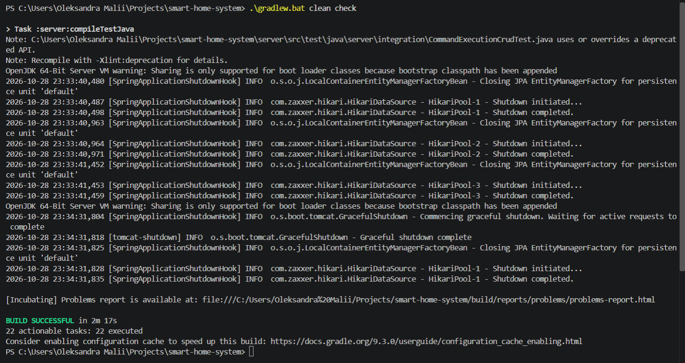
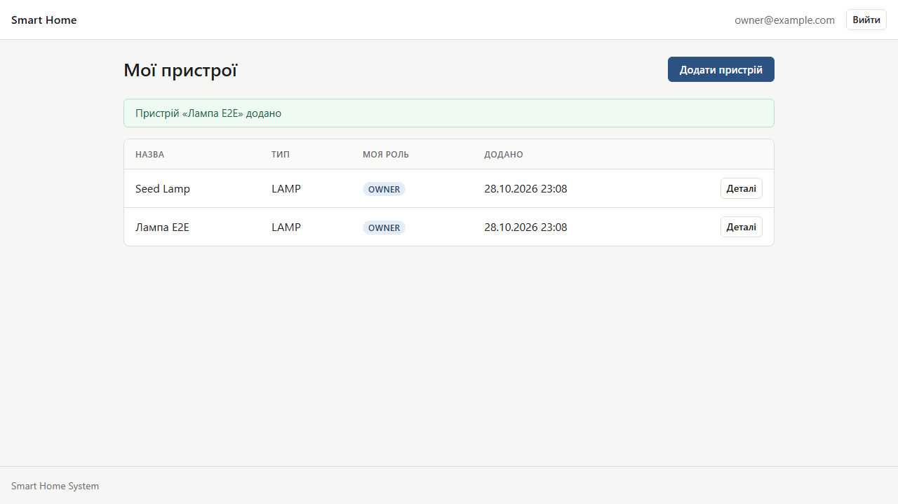
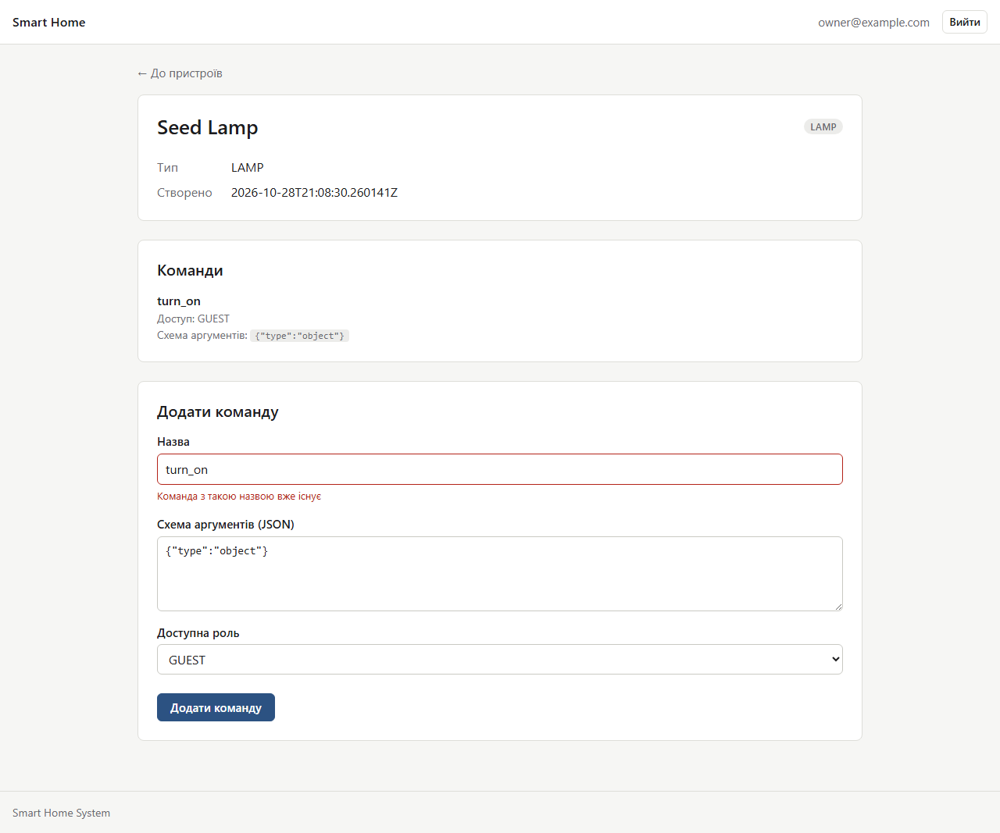
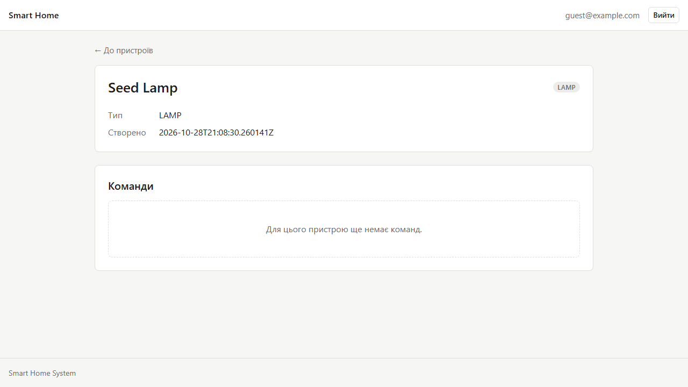

# Звіт за груповим завданням 10

Тести з повним контекстом Spring тепер працюють на справжньому PostgreSQL у Docker (Testcontainers) замість H2. Додано тести REST API на запущеному сервері та браузерні тести Playwright. Усі інтеграційні класи мають спільну анотацію `@IntegrationTest`, end-to-end класи `@E2ETest`, тому контекст Spring і база стартують один раз на весь набір. Після кожного тесту `reset-data.sql` лишає в базі тільки початкові дані.

## Тести за рівнями

| Рівень | Класів | Тестів | Час, с |
|---|---|---|---|
| Модульні (Mockito) | 20 | 127 | 3,3 |
| Межі модулів (`ApplicationModulesTest`) | 1 | 1 | 4,9 |
| Зрізи веб-шару (`@WebMvcTest`) | 8 | 74 | 8,1 |
| Зрізи репозиторіїв (`@DataJpaTest`) | 4 | 22 | 10,4 |
| Інтеграційні (MockMvc + PostgreSQL) | 11 | 48 | 32,3 |
| Модуль автоконфігурації | 1 | 5 | 1,7 |
| End-to-end REST API (`RestTestClient`) | 1 | 3 | 26,9 |
| Браузерні (Playwright) | 1 | 3 | 19,8 |
| **Разом** | **47** | **283** | **107,5** |

Усі тести виконуються за 107,5 с: швидкі та інтеграційні (`test`) за 60,8 с, end-to-end (`e2eTest`) за 46,7 с. Увесь `.\gradlew.bat clean check` разом зі збіркою пройшов за 2 хв 17 с.

## Результат запуску

Усі 283 тести зелені, пропущених немає.

## Що врахували

- У тестах REST входимо через `POST /api/login`: `@WithMockUser` на `/api/**` без сесій не працює.
- У GitHub Actions образ закріплено на `ubuntu-24.04`, бо на Ubuntu 26.04 Playwright не встановлюється.
- WireMock не потрібен: зовнішніх HTTP-сервісів немає, пристрій емулюється всередині застосунку.

## Браузерні тести

### Власник додає пристрій

Результат: з'являється повідомлення «Пристрій «Лампа E2E» додано» і новий рядок з роллю OWNER.

### Дубль команди

Результат: другу команду `turn_on` не додано, під полем «Назва» помилка «Команда з такою назвою вже існує».

### Гість не бачить форми додавання команди

Результат: у гостя на сторінці пристрою є список команд, але немає форми «Додати команду».
