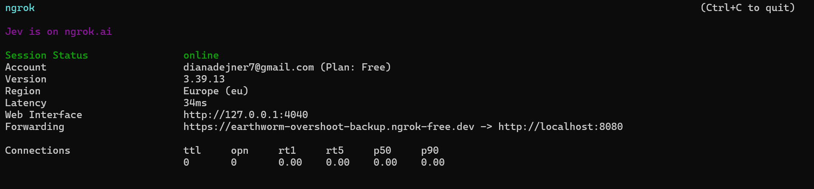
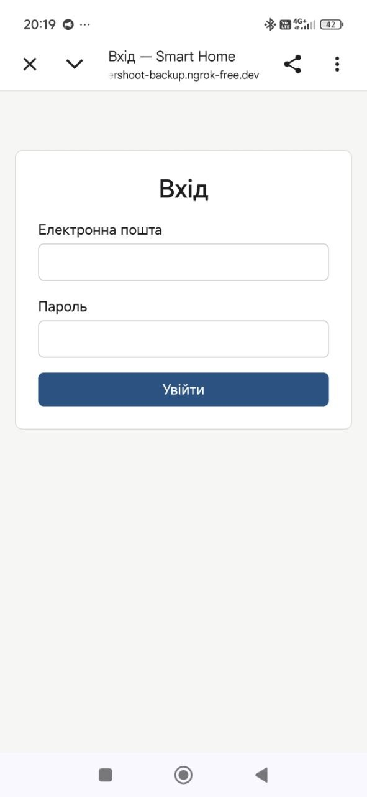
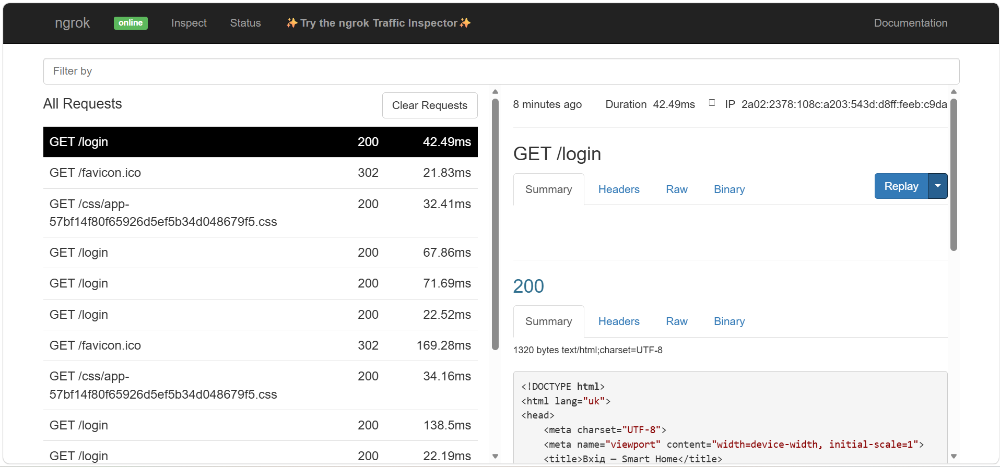
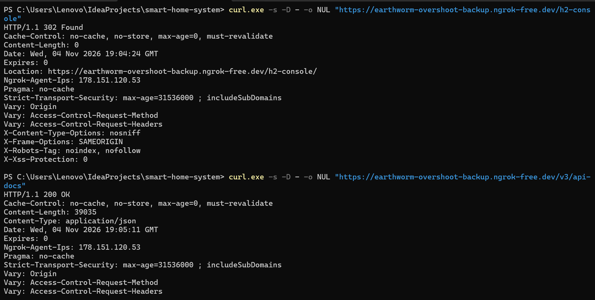

# Звіт за груповим завданням 9

## Архітектура розгортання

Сервер і PostgreSQL працюють у Docker Compose. Ngrok відкриває вихідне з'єднання до свого сервера й передає зовнішні HTTPS-запити на `127.0.0.1:8080`, тому білий IP і налаштування роутера не потрібні.

```text
Користувач ──HTTPS──▶ Ngrok ──тунель──▶ localhost:8080 ──▶ контейнер server ──▶ контейнер db (PostgreSQL 17)
```

Docker дає відтворюваний запуск сервера й бази з постійним томом даних. Ngrok відкриває доступ з Інтернету без змін у мережі; адреса безкоштовного тунелю тимчасова.

## Файли конфігурації

- [`Dockerfile`](../Dockerfile): багатостадійна збірка JAR модуля `server`, образ на Java 25 JRE, запуск від непривілейованого користувача `10001`.
- [`docker-compose.yml`](../docker-compose.yml): сервіси `db` і `server`, healthcheck бази, постійні томи, порт лише на `127.0.0.1:8080`. Пароль БД і `JWT_SECRET` обов'язкові.
- [`.env.example`](../.env.example): шаблон `POSTGRES_DB`, `POSTGRES_USER`, `POSTGRES_PASSWORD`, `JWT_SECRET`. Локальний `.env` і токен Ngrok не потрапляють у репозиторій та архів.
- [`application-prod.properties`](../server/src/main/resources/application-prod.properties): graceful shutdown, довірені заголовки проксі, secure/HttpOnly/SameSite cookie; `security.jwt.secret=${JWT_SECRET}` без запасного значення; вимкнені H2-консоль, OpenAPI і Swagger UI. Ланцюжок `toolsFilterChain` і лог прикладу хешу пароля в prod не створюються (`@Profile("!prod")`).

Запуск: створити `.env` за `.env.example`, виконати `docker compose up -d --build`, потім `ngrok http 8080`.

## Доступ через Ngrok

### Тунель


Результат: статус `online`, адреса `https://earthworm-overshoot-backup.ngrok-free.dev` пересилає на `http://localhost:8080`. Токена на знімку немає.

### Сторінка входу на телефоні


Результат: через мобільний Інтернет (4G) відкривається `/login`, вхід під `owner@example.com` проходить, після входу адреса лишається `https://`.

### Панель Ngrok


Результат: у `http://127.0.0.1:4040` видно запити `GET /login` → `200` через публічну адресу. Колекція Postman (Newman) через публічну адресу теж пройшла.

## Перевірки захисту

### Перший запуск, до закриття службових сторінок


Результат: `/v3/api-docs` віддавав `200 OK`, `/swagger-ui.html` вів на відкритий Swagger UI, `/h2-console` перенаправляв на `/h2-console/`. Після цього в prod закрили JWT-секрет, Swagger, OpenAPI і H2 (#137).

### Повторна перевірка

Образ перезібрано, перевірки повторено на `http://localhost:8080`, куди Ngrok пересилає запити:

```text
GET /login                  -> 200
GET /swagger-ui.html        -> 302 /login
GET /swagger-ui/index.html  -> 302 /login
GET /v3/api-docs            -> 302 /login
GET /h2-console             -> 302 /login
GET /h2-console/            -> 302 /login

POST /api/users  -> 201 {"id":"b5cf28a5-…","email":"lab9-…@example.com","name":"Lab9",…}
POST /api/login  -> 200 {"accessToken":"…","tokenType":"Bearer","expiresIn":900}

newman run postman/collection.json: requests 7/0 failed, assertions 11/0 failed

prod без JWT_SECRET: Could not resolve placeholder 'JWT_SECRET' … Application run failed
```

Службові сторінки без входу недоступні, REST і колекція Postman працюють, без секрету сервер не стартує. Хеш демо-пароля в лог prod більше не пишеться.

## Перевірки розгортання

| Перевірка | Результат |
|---|---|
| `docker compose up` без `.env` | Відмова: не задані обов'язкові змінні |
| `docker compose exec server id` | `uid=10001(smarthome)`, не root |
| `docker compose exec server kill 1` | Контейнер перезапустився за політикою `restart` |
| `docker compose stop server` | У лозі коректне зупинення Tomcat і пулу HikariCP |
| `docker compose down`, потім `up -d` | Користувачі й пристрої збереглися в томі `pgdata` |

## Ризики, що лишилися

- Відкрита реєстрація через `POST /api/users`.
- Seed-акаунти з відомим паролем `Passw0rd123` лишаються в prod.
- Немає перевірки прав на `/api/users`, `/api/devices` і виконання команд: будь-який зареєстрований користувач може змінювати й видаляти чужі дані.
- Ідентифікація заголовком `X-User-Id` без перевірки.
- Немає обмеження спроб входу.
- `spring.jpa.hibernate.ddl-auto=update` замість міграцій.
- Адреса Ngrok тимчасова, токен Ngrok є секретом.
